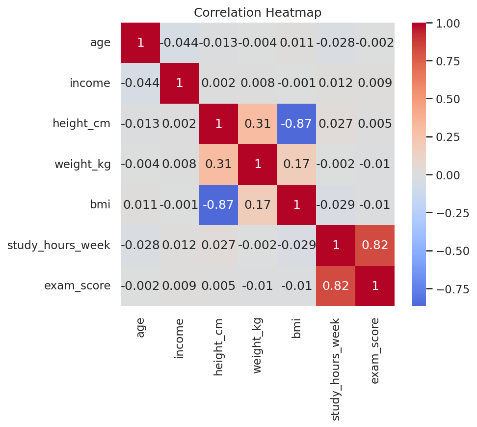
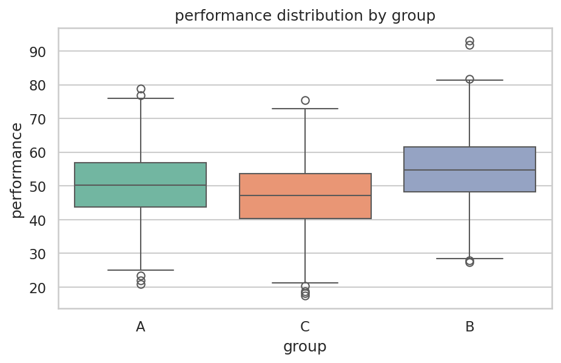

# Statistical Analysis Portfolio Project


This is an end-to-end applied statistics project on a synthetic dataset (2,000 rows × 22 variables). I designed the data to cover the main variable types and the hypothesis tests used in practice. I wanted to show the whole workflow, from data cleaning and exploratory analysis to hypothesis testing, correlation and regression, in clean, tested, reusable Python code instead of one throwaway notebook.

> **Note on the data:** the dataset is fully synthetic. I generated it for this project, so the results describe patterns in simulated data. The point here is the statistical workflow, not the conclusions. Being synthetic also means the project is fully reproducible and has no privacy concerns.

## Key findings

| Question | Test | Result |
|---|---|---|
| Does treatment increase scores? | Welch's t-test | The drug group scored significantly higher than placebo (t = 12.37, p < .001, Cohen's d = 0.55, medium effect) |
| Do scores improve from before to after? | Paired t-test | Significant increase (t = -34.62, p < .001, d = 0.77, medium-large effect) |
| Does performance differ across groups A/B/C? | ANOVA + Tukey HSD | Significant group effect (F = 105.52, p < .001, η² = 0.10), and all three pairwise comparisons are significant |
| Is smoking associated with disease? | Chi-square | Significant association (χ² = 180.34, p < .001) |
| Do study hours predict exam score? | OLS regression | Each extra weekly study hour adds 2.81 exam points (R² = 0.67) |
| Does exam score predict passing? | Logistic regression | Exam score is a significant predictor (OR = 1.08 per point, p < .001). Study hours stop being significant once exam score is in the model, so their effect on passing seems to go through exam score |

I cross-checked every parametric result with a non-parametric counterpart (Mann-Whitney U, Wilcoxon, Kruskal-Wallis), and they all reached the same conclusion. See Section 8 of the notebook.

## Sample output

<table>
  <tr>
    <td width="50%"></td>
    <td width="50%"></td>
  </tr>
  <tr>
    <td align="center">Correlation Heatmap</td>
    <td align="center">Performance by Group</td>
  </tr>
</table>

## Project goals

- Apply core statistical concepts (descriptive statistics, hypothesis testing, correlation, regression) to a realistic, messy dataset with missing values and outliers
- Pick the right test based on data type and distribution (parametric or non-parametric), and cross-check parametric results against non-parametric ones
- Report effect sizes (Cohen's d, eta-squared, odds ratios) next to p-values, because significance alone doesn't say how big an effect is
- Write modular, unit-tested Python code instead of one giant notebook
- Explain results clearly with visualizations and plain-language interpretation

## Dataset overview

| Variable type | Columns | Purpose |
|---|---|---|
| Nominal | gender, education, city, treatment, group, smoker, has_disease | Chi-square, group comparisons |
| Continuous (approx. normal) | age, height_cm, weight_kg, bmi, score_before/after, performance | t-tests, ANOVA, correlation |
| Continuous (right-skewed) | income | Normality testing, log transformation |
| Ordinal | job_satisfaction_1to5 | Non-parametric tests |
| Count | children_count | Poisson-like count data |
| Binary | passed_exam | Logistic regression |
| Date | register_date | Time-based grouping |

The dataset has intentional missing values (income, height, job satisfaction, children count) and injected outliers, so I could practice real-world cleaning with IQR/Z-score detection and winsorizing.

## Methods covered

- Data cleaning: missing-value imputation, IQR/Z-score outlier detection, winsorizing
- Descriptive statistics: mean, median, mode, variance, skewness, kurtosis, 95% confidence intervals
- Normality testing: Shapiro-Wilk, with a discussion of its over-sensitivity at large n
- Parametric tests: one-sample, independent and paired t-tests, one-way ANOVA with Tukey HSD post-hoc
- Non-parametric tests: Mann-Whitney U, Wilcoxon signed-rank, Kruskal-Wallis (used to validate the parametric results)
- Association tests: chi-square test of independence
- Effect sizes: Cohen's d (t-tests), eta-squared (ANOVA), odds ratios (logistic regression)
- Correlation: Pearson, Spearman, correlation heatmap
- Regression: simple and multiple OLS with diagnostics, logistic regression with odds ratios

## Project structure

```
stats-project/
├── data/
│   └── comprehensive_dataset.csv      # 2,000 rows × 22 columns, mixed variable types
├── notebooks/
│   └── statistical_analysis.ipynb     # Main analysis notebook (the report)
├── src/
│   ├── data_loader.py                 # Loading, missing-value handling, outlier detection
│   ├── descriptive_stats.py           # Summary statistics, confidence intervals
│   ├── hypothesis_tests.py            # t-tests, ANOVA, chi-square, non-parametric tests, effect sizes
│   ├── correlation_regression.py      # Pearson/Spearman, OLS & logistic regression
│   └── visualization.py               # Reusable plotting functions
├── tests/
│   └── test_statistics.py             # Unit tests for src/ (pytest)
├── outputs/
│   └── figures/                       # Saved charts (.png)
├── requirements.txt
└── README.md
```

## How to run

```bash
git clone https://github.com/ParnazAli/statistical-analysis-project.git
cd statistical-analysis-project
pip install -r requirements.txt
jupyter notebook notebooks/statistical_analysis.ipynb
```

To run the test suite:

```bash
pytest tests/ -v
```

The notebook imports all its logic from `src/`, so each statistical method can also be reused on its own:

```python
from src.hypothesis_tests import independent_ttest
result = independent_ttest(group_a, group_b, label="A vs B")
# {'test': 'Independent t-test (Welch)', 'p_value': ..., 'cohens_d': ..., 'effect_size': 'medium'}
```

## Tech stack

`Python` · `pandas` · `numpy` · `scipy` · `statsmodels` · `matplotlib` · `seaborn` · `pytest` · `Jupyter`

## License

MIT License. Feel free to use this project structure for your own learning.

## Author

Hi, I'm Parnaz Ali, the author of this project. If you have questions or want to talk about it, send me an email.

[](mailto:parnazali1383@gmail.com)
